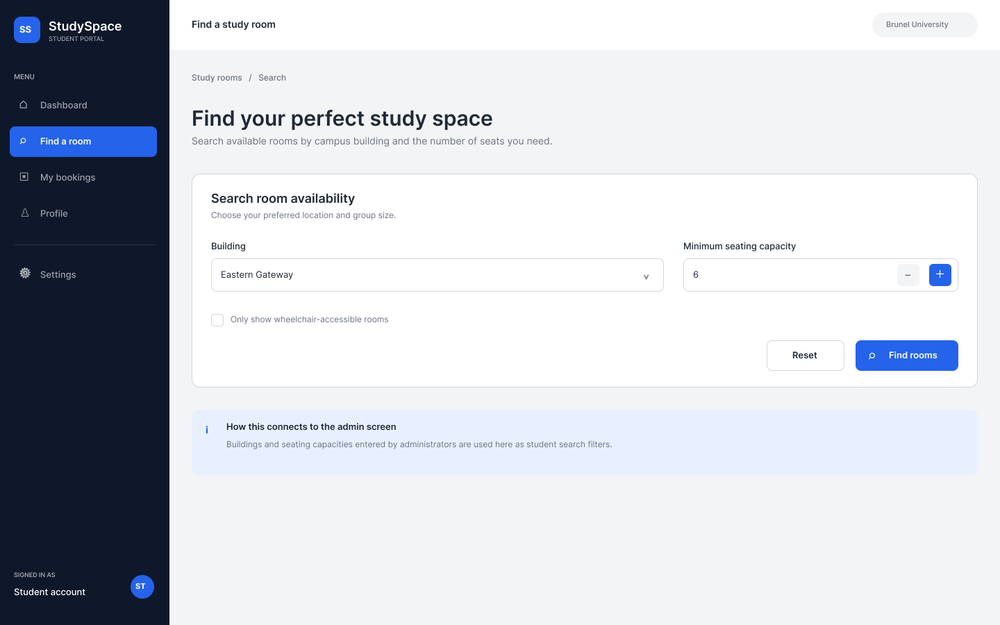
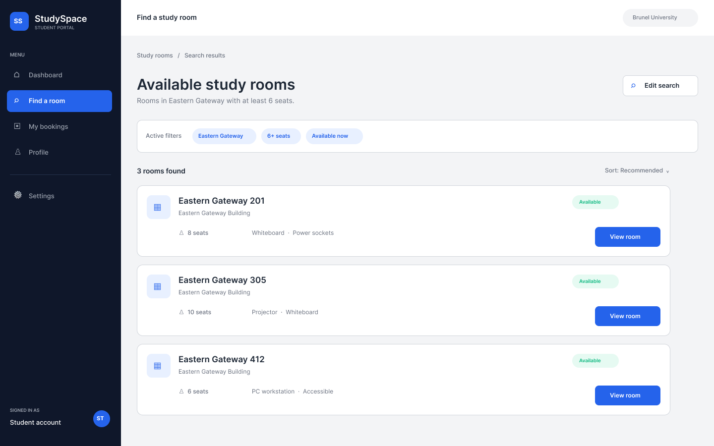

# StudySpace room search designs

These student-facing screens extend the administrator room-management flow.
Administrators create rooms with a building, seating capacity, facilities and
availability; students then use that information to find a suitable room.

## Search by building and capacity

Supports:

- **U003** — Search for study rooms by building.
- **U009** — Filter study rooms by seating capacity.
- Optional filtering for wheelchair-accessible rooms.

## Filtered room results

The results retain the selected building and capacity filters and show matching
rooms with their seating capacity, facilities and current availability.

## Editable source

[Open the Figma design](https://www.figma.com/design/9frw6VAeAqxYkmriDcqLry/StudySpace-Admin-%E2%80%93-Add-New-Study-Room?node-id=7-3&p=f)
