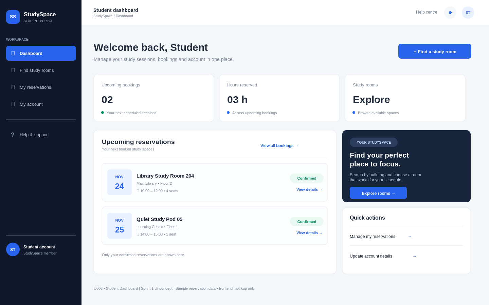

# U006 — Student Dashboard Interface

**CS3617 StudySpace — Group A9**  
**Contributor:** Karam Pal Singh (Brunel student ID 2405886)  
**Jira:** [SCRUM-43 — U006 Access personal dashboard](https://brunel-team-z4cepav5.atlassian.net/browse/SCRUM-43)  
**Editable design:** [Figma — U006 Student Dashboard, Desktop 1440 × 900](https://www.figma.com/design/jUVM1IHtAioYmFGX8Ft01m?node-id=1-2)

## Student Dashboard concept

[Open scalable SVG preview](./StudySpace_U006_Student_Dashboard.svg)

## Scope

- Dashboard navigation to find study rooms, reservations, account and help.
- Overview cards for upcoming bookings, hours reserved and room discovery.
- Upcoming reservations with date, room, location, time, seating and status.
- Prominent booking/search entry point and quick-access actions.
- 1440 × 900 desktop visual design with the group's navy, blue, white and light-grey palette.

## Boundaries and handoff

- The Figma layout is the editable design source; PNG/SVG exports are visual previews.
- Booking dates, counts and reservation data are **illustrative placeholders**.
- This submission is **UI design only**; it does **not** claim backend connectivity, functional routes, accessibility validation, or end-to-end tests.
- Integrate and validate dashboard functionality before marking the entire U006 feature Done.

The folder follows the contributor-specific design structure described by the group's `design/README.md`.
